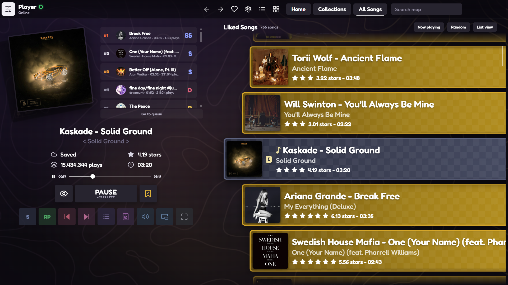
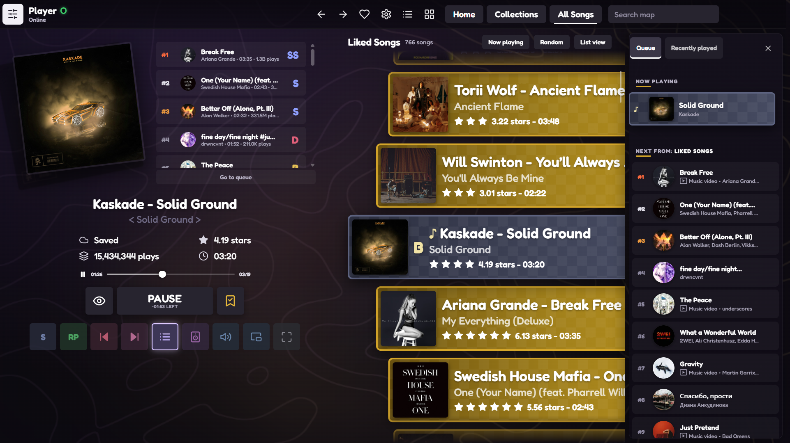
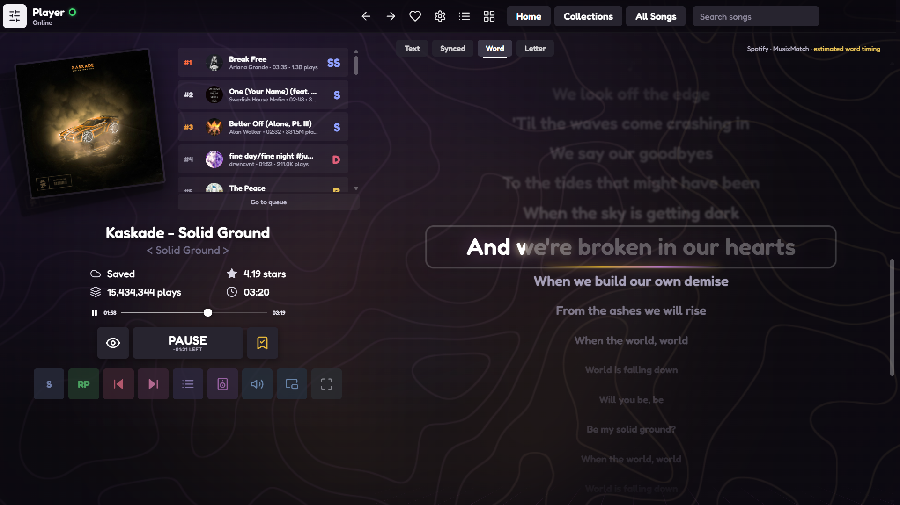
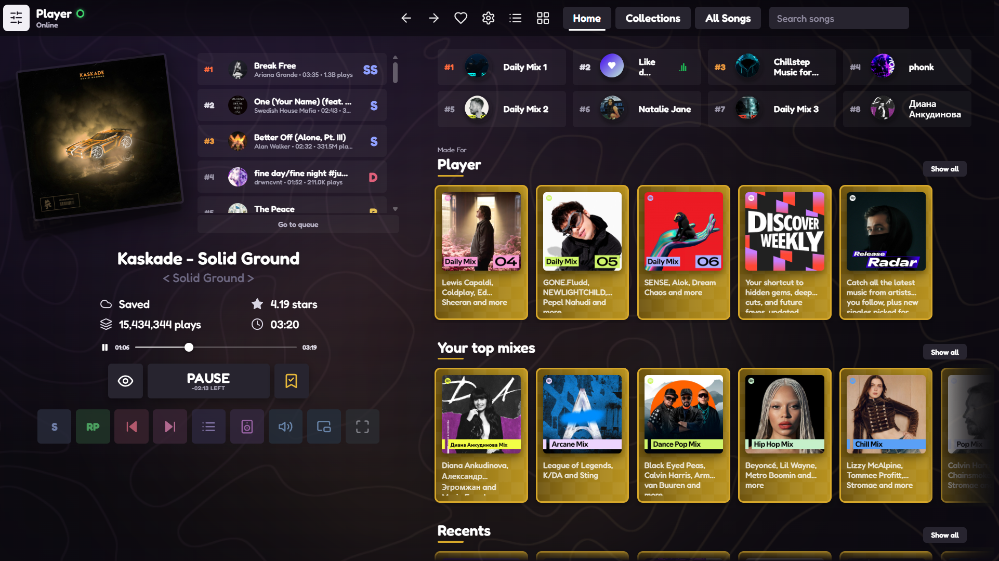
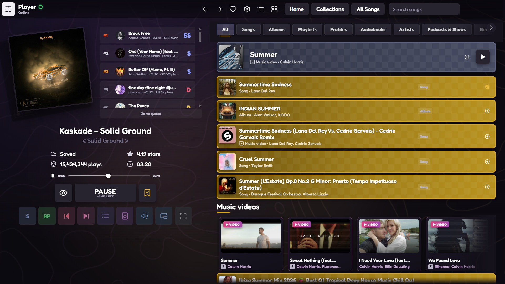

<h1 align="center">Rhythia for Spotify</h1>

<p align="center"><b>Your music library, as a rhythm-game song select.</b><br>
Scroll the wheel, the song in the middle plays.</p>

<p align="center">
  
</p>

<p align="center">
  <a href="#install">Install</a> ·
  <a href="#features">Features</a> ·
  <a href="#lyrics">Lyrics</a> ·
  <a href="#faq">FAQ</a>
</p>

---

Rhythia is a [Spicetify](https://spicetify.app) theme that rebuilds Spotify's layout around the song select screen of rhythm games like Rhythia and osu!. It isn't a recolor. It adds a song wheel, a now-playing panel with a leaderboard, game-style controls, a note-highway lyrics view and a background that moves with the beat.

## Features

### 🎡 Scroll-to-play song wheel
Liked Songs, playlists and albums become a smooth, staggered wheel of map cards. Scroll, drag or use the arrow keys, and the card that settles in the middle starts playing in its playlist, so next and previous still follow the list. Every card shows stars and a grade (SS to D) based on the song's play count. Use **Random** to jump somewhere, **Now playing** to snap back, and type in the top bar to filter the wheel.

### 🏆 Now-playing panel and leaderboard queue
The tilted cover art with a ghost card behind it, "Artist - Title", `< Album >`, saved state, stars, play count and length. Up next is shown as a ranked leaderboard with grades. Below that are a seek bar, a **PLAY** slab and a row of colored mod buttons: shuffle, repeat, previous, next, queue, devices, volume, miniplayer and fullscreen.

<p align="center"></p>

### 🎤 Note-highway lyrics with 4 sync modes
| Mode | What you get |
|---|---|
| **Text** | Plain lyrics you can scroll through |
| **Synced** | Lines fly toward you and the current line hits with a glow |
| **Word** | Each word fills as it's sung |
| **Letter** | Letters light up and pop one by one |

Click any line to jump there. A label shows the lyrics source and whether the timing is real or estimated.

<p align="center"></p>

### 🗺️ Music-reactive topographic background
A WebGL shader draws soft contour lines that drift with the music. They pulse gently on each beat and move faster in loud parts, using Spotify's own beat and loudness analysis. The lines are tuned to stay subtle, sit over a blurred copy of the current cover, and stop rendering when Spotify is minimized.

### 🏠 Home, Search and Video
- **Home:** your shortcuts become a ranked leaderboard, and every mix and playlist becomes a gold map card.
- **Search:** results drop into place one by one with a stacking animation. The top result gets the "selected" card, and music videos get their own cinema cards.
- **Video:** a custom Rhythia control bar (play, seek, volume, switch to audio, full screen) replaces Spotify's player bar in the video view.
- **Side panels:** the queue and library slide in and push the layout instead of covering it.

<p align="center"> </p>

## Install

### Spicetify Marketplace (recommended)
1. Install the [Spicetify Marketplace](https://github.com/spicetify/marketplace) if you don't have it.
2. Open **Marketplace → Themes** and search for **Rhythia**.
3. Click **Install**. That's it.

### Manual
You need [Spicetify](https://spicetify.app) 2.x installed.

```bash
# go to your Spicetify Themes folder
cd "$(spicetify path userdata)/Themes"

# download the theme
git clone https://github.com/nukedrust-pixel/Rhythia

# enable it (theme.js is required: it powers the wheel, panel, lyrics and background)
spicetify config current_theme Rhythia color_scheme Base inject_css 1 inject_theme_js 1 replace_colors 1
spicetify apply
```

To update, run `git pull` inside the `Rhythia` folder and then `spicetify apply`.

To switch away, pick another theme in the Marketplace, or run `spicetify config current_theme <OtherTheme>` and then `spicetify apply`.

## Controls

| Where | Input | Action |
|---|---|---|
| Song wheel | Mouse wheel, drag, ↑ ↓ | Move the wheel; the middle song plays when it stops |
| Song wheel | PgUp / PgDn, Home / End | Jump 6 songs, or to the first or last song |
| Song wheel | Enter, or click the middle card | Play or pause |
| Song wheel | Type in the top bar | Filter the wheel (Esc clears it) |
| Volume button | Scroll | Change volume |
| Lyrics | Click a line | Seek to that line |
| Top-left avatar | Click | Open or close your library |

## Lyrics

Lyrics come from free sources, checked in this order:

1. **Spotify's own lyrics**, line-synced and syllable-synced where Spotify has them.
2. **[LRCLIB](https://lrclib.net)**, a free, open lyrics database with plain and synced lyrics and occasional word timing.

When a song has only line timing, Word and Letter modes spread each line's time across its words and letters. These modes are labelled **estimated**.

## FAQ

**I installed it from the Marketplace but nothing changed.**
The Marketplace can only apply themes when Spicetify's current theme is set to `marketplace`. Run this, then reopen Spotify:
```bash
spicetify config current_theme marketplace inject_css 1 replace_colors 1 inject_theme_js 1
spicetify apply
```
If it still looks like normal Spotify, remove Rhythia under **Marketplace → Installed**, restart Spotify and install it again.

**Something looks off after a Spotify update.**
Spotify renames its internal styles from time to time. Open an issue with a screenshot and your Spotify and Spicetify versions.

**Does it send my data anywhere?**
No tracking. The theme only talks to Spotify's own APIs (play counts, lyrics, audio analysis), LRCLIB (lyrics), Google Fonts (the Fredoka font) and, if you installed through the Marketplace, jsDelivr (to load `theme.js`).

**Can I use Spotify's normal list instead of the wheel?**
Yes. Click **List view** at the top of the wheel, and **Wheel view** to switch back.

**Tested with:** Spotify 1.2.90 and 1.3.6 with Spicetify 2.46 on Windows.

## Credits

The design is inspired by the song select screen of the rhythm game Rhythia. This is a fan-made Spotify theme and isn't affiliated with or endorsed by Rhythia or Spotify.

Font: [Fredoka](https://fonts.google.com/specimen/Fredoka). Lyrics: [LRCLIB](https://lrclib.net).

## License

[MIT](LICENSE)
